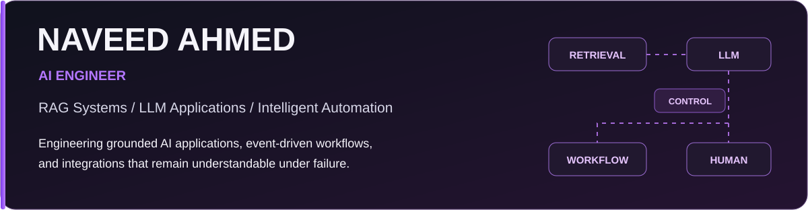
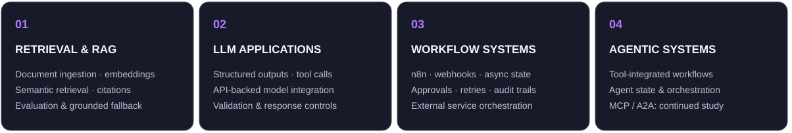
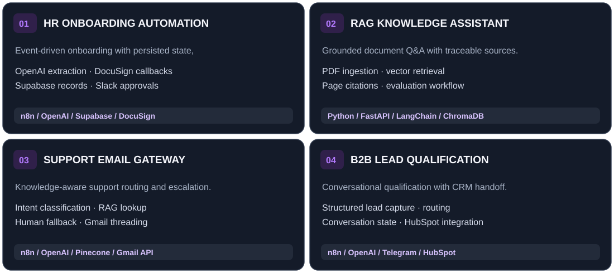
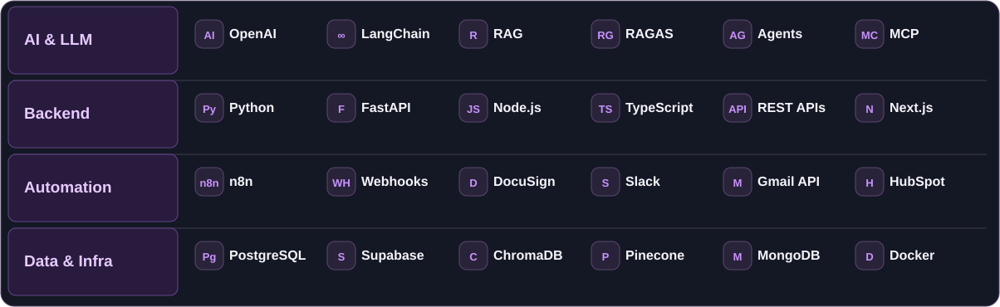
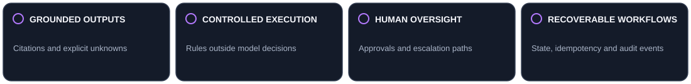

 &nbsp; 

I develop AI applications around real business processes—retrieval pipelines, structured model outputs, API integrations, and event-driven automation. I focus on the less visible engineering work: preserving state across external events, making outputs traceable, and defining where automated decisions should stop.

## Engineering Focus

## Selected Engineering Work

### [HR Onboarding Automation Engine](https://github.com/Naveed786Ahmed/HR-Onboarding-Automation-Engine)

An n8n-based workflow coordinating AI-assisted resume extraction, candidate records, document signing, and manager approvals. The central design choice is **database-backed onboarding state**: DocuSign and Slack webhook events advance separate stages instead of requiring one continuously running execution.

**Implementation:** structured extraction and validation · candidate deduplication · Supabase state transitions · DocuSign sandbox callbacks · Slack approval paths · audit events. **IT provisioning is simulated**, not a live identity-system deployment.

[**Explore repository & architecture**](https://github.com/Naveed786Ahmed/HR-Onboarding-Automation-Engine) · [**Watch system walkthrough**](https://youtu.be/gcYUnXp-SOg)

<b>More about the other projects</b>

**Enterprise RAG Knowledge Assistant** — Python/FastAPI retrieval service using document chunks, embeddings, page-level source metadata and grounded-answer fallback. Evaluation workflow designed around RAGAS.

**AI Customer Support Email Gateway** — n8n pipeline for support intent classification, retrieval-backed drafting, confidence-based escalation, and Gmail thread preservation.

**B2B Conversational Lead Qualification Agent** — n8n conversational qualification with structured data capture, deterministic routing, state handling, deduplication, and HubSpot CRM integration.

*Public repository links will be added when their source and documentation are available.*

## Technical Stack

Primary implementation tools include Python, FastAPI, OpenAI API, LangChain, n8n, Supabase, ChromaDB, and REST integrations. Agent architectures and MCP are areas of ongoing technical development, not claims of production deployment. Additional software development background: React, JavaScript, Express.js, Flutter, Git.

## Engineering Approach

---

**Interested in the implementation details?** Explore the code and architecture, or connect about AI engineering and workflow automation.

 &nbsp; 

