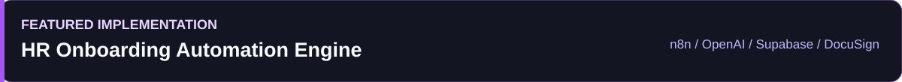

  
  &nbsp;
  

I work on AI applications that need to do more than return a plausible answer. My projects deal with retrieving evidence from documents, integrating language models with existing systems, and keeping multi-step automation predictable when external services or human decisions are involved.

## Engineering Focus

| LLM & RAG Systems | Workflow Automation | Agentic Applications | Backend & Integrations |
|:---|:---|:---|:---|
| Document ingestion, semantic retrieval, citations, evaluation | Webhook orchestration, execution state, approvals | Tool use, context management, agent patterns | Python APIs, data contracts, external services |

## Selected Work

**[HR Onboarding Automation Engine](https://github.com/Naveed786Ahmed/HR-Onboarding-Automation-Engine)**

An event-driven onboarding workflow connecting candidate intake, AI-assisted resume extraction, document signing and manager approvals. The key design decision is to persist candidate state in Supabase so later DocuSign and approval events can advance the process without relying on a continuously running execution.

`n8n` `OpenAI API` `Supabase PostgreSQL` `DocuSign` `Slack` `Webhooks`

[Explore repository and architecture](https://github.com/Naveed786Ahmed/HR-Onboarding-Automation-Engine) · [Watch workflow walkthrough](https://youtu.be/gcYUnXp-SOg)

<table>
<tr><td width="50%" valign="top">

### Enterprise RAG Knowledge Assistant
**Document-grounded answers with traceable sources.**

PDF ingestion, chunking and embedding-based retrieval, with document/page metadata carried through to citations. Includes a fallback when the retrieved context does not support an answer and an evaluation workflow using RAGAS.

`Python` `FastAPI` `LangChain` `ChromaDB` `OpenAI`

</td><td width="50%" valign="top">

### AI Customer Support Email Gateway
**Support classification, retrieval and controlled escalation.**

Processes incoming messages, routes support requests to a knowledge-retrieval step, and escalates cases without adequate context. Gmail message and thread identifiers are retained for replies in the original conversation.

`n8n` `OpenAI` `Pinecone` `Gmail API`

</td></tr>
<tr><td width="50%" valign="top">

### B2B Lead Qualification Agent
**Conversational intake connected to CRM workflows.**

Collects structured prospect details, routes leads through defined qualification branches and integrates outcomes with HubSpot. Conversation state and duplicate handling are part of the workflow design.

`n8n` `OpenAI` `Telegram` `HubSpot`

</td><td width="50%" valign="top">

### Software Engineering Foundation
**Web and mobile application development.**

Earlier work includes a Flutter-based agricultural-market ledger developed as a university team project and a full-stack microfinance application built during a hackathon.

`Flutter` `Node.js` `MongoDB` `React`

</td></tr>
</table>

## Technical Stack

The tools below reflect my project work and software development background. I keep architecture concepts separate from technology logos so the stack remains readable.

**AI application development**

 &nbsp; **Python · FastAPI · OpenAI API · LangChain · RAG · RAGAS**

**Automation and integrations**

 &nbsp; **n8n · REST APIs · Webhooks · DocuSign · Slack · Gmail API · HubSpot**

**Data, retrieval and infrastructure**

 &nbsp; **ChromaDB · Pinecone · PostgreSQL · Supabase · MongoDB · Docker**

**Software development**

### Agentic AI: Areas of Study

Agent SDKs, tool calling, memory and context strategies, MCP, A2A, multi-agent orchestration and evaluation. These are areas of continued technical development, not claims of production deployment.

## How I Approach Engineering

| Grounded responses | Controlled execution | State and recovery | Human oversight |
|:---|:---|:---|:---|
| Preserve source context and define fallback behavior. | Keep business rules explicit around LLM decisions. | Design for webhook retries, duplicate events and interrupted workflows. | Route uncertain or consequential decisions for review. |

## Connect

I am open to AI engineering roles and technical collaborations involving LLM applications, RAG and workflow automation.

 

<!-- To add an Email button after confirming a public contact address:

-->
