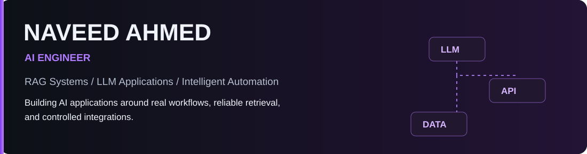

 

 &nbsp;  &nbsp; 

 

I engineer AI applications that connect language models to business processes and internal knowledge. My recent work spans document-grounded retrieval, structured LLM extraction, asynchronous workflow execution, and human-in-the-loop decisions.

## Engineering Focus

## Selected Work

**[HR Onboarding Automation Engine — source, architecture & setup](https://github.com/Naveed786Ahmed/HR-Onboarding-Automation-Engine)** · **[Workflow walkthrough](https://youtu.be/gcYUnXp-SOg)**

The onboarding system coordinates OpenAI-assisted candidate extraction, Supabase-backed records, DocuSign signature events, and Slack manager approvals. The key design decision is to persist onboarding state so webhook-triggered stages can progress without treating the entire process as one continuously running execution. IT account provisioning is **simulated**, not a live identity-system integration.

The other three cards summarize engineering projects; repository links will be added when their public source and documentation are ready.

## Technical Stack

<table>
<tr><th align="center">AI &amp; LLM</th><th align="center">Backend</th><th align="center">Automation</th><th align="center">Data &amp; Infrastructure</th></tr>
<tr>
<td align="center" width="25%"> &nbsp;  OpenAI · LangChain</td>
<td align="center" width="25%"> &nbsp;  &nbsp;  Python · FastAPI · Node.js</td>
<td align="center" width="25%"> &nbsp;  n8n · APIs · Webhooks</td>
<td align="center" width="25%"> &nbsp;  &nbsp;  PostgreSQL · Supabase · Docker</td>
</tr>
</table>

Additional experience: ChromaDB, Pinecone, MongoDB, Git, REST integrations and JavaScript/TypeScript.

## Engineering Principles

<b>Agentic AI — ongoing technical development</b>

 
Exploring agent SDKs, memory architectures, MCP, agent-to-agent communication, multi-agent design and evaluation. These are areas of continued development rather than claims of production deployment.

---

**Explore the implementations, not just the demos.**

 &nbsp; 

